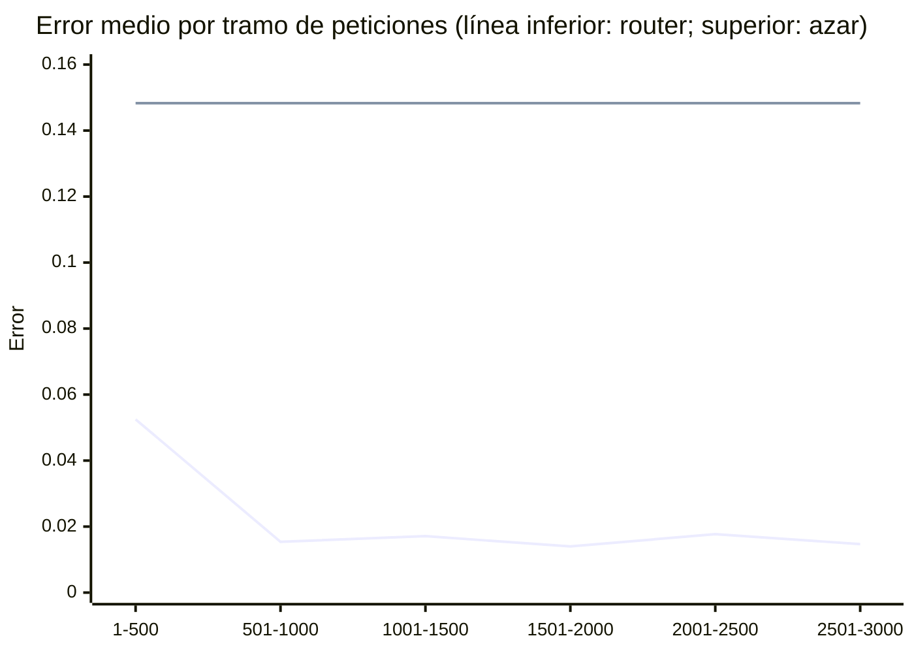

# Azuma Router — Informe de pruebas de extremo a extremo

- **Fecha:** 2026-10-23
- **Versión:** 0.1.0 · rama `fix/e2e-max-pending` · commit `ddd63ce`
- **Resultado global:** ✅ APROBADO — 42 de 42 comprobaciones superadas

Este informe resume qué hace hoy la herramienta cuando se la usa de verdad: se arranca el servicio real, se le envía tráfico simulado y se mide lo que ocurre. Se genera con un solo comando (ver «Cómo reproducirlo») y cada sprint añade una versión nueva, de modo que se puede seguir la evolución.

## Resumen ejecutivo

Azuma Router decide, para cada petición, a qué modelo de lenguaje enviarla, y aprende de los resultados para decidir mejor la vez siguiente, respetando las cuotas de suscripción.

| Escenario | Resultado |
|---|---|
| 1. Aprendizaje y rendimiento | ✅ APROBADO (15/15 comprobaciones) |
| 2. Gestión de la cuota | ✅ APROBADO (4/4 comprobaciones) |
| 3. Recuperación ante caídas | ✅ APROBADO (5/5 comprobaciones) |
| 4. Entradas hostiles | ✅ APROBADO (18/18 comprobaciones) |

**En una frase por escenario** (solo se afirma lo que ha superado sus comprobaciones):

- ✅ **Aprende:** tras 3,000 peticiones elige el mejor modelo en el 91% de los casos y su error es 10% del que tendría repartiendo al azar.
- ✅ **Respeta la cuota:** frena por sí mismo el uso del modelo con cuota limitada y nunca la supera.
- ✅ **Resiste caídas:** tras un apagado brusco no se pierde ningún dato confirmado.
- ✅ **Resiste entradas hostiles:** mensajes malformados o abusivos se rechazan con un error claro y el servicio sigue funcionando.

> Es el primer informe: la sección «Evolución» se irá llenando en los siguientes.

## Qué se ha probado y cómo

No se usan modelos reales: se construye un **mundo simulado** con tres modelos cuyo comportamiento verdadero conocemos (calidad, precio y velocidad por tipo de tarea). Como conocemos la respuesta correcta, podemos medir cuánto se equivoca el router. El servicio que se prueba es el **real**: se arranca como proceso independiente y se le habla por su interfaz estándar, igual que lo haría una aplicación cliente.

**Calidad de cada modelo por tipo de tarea (0 a 1, más es mejor):**

| Modelo | Editar código | Planificar | Resumir | Extraer datos | Conversar |
|---|---|---|---|---|---|
| gpt-5-codex (suscripción con cuota) | 0.92 | 0.85 | 0.70 | 0.70 | 0.75 |
| qwen3-coder (pago por uso) | 0.80 | 0.65 | 0.60 | 0.93 | 0.70 |
| claude-haiku (pago por uso) | 0.55 | 0.60 | 0.90 | 0.75 | 0.88 |

**Mejor modelo para cada tarea una vez ponderados calidad, coste y velocidad (es la respuesta que el router debe descubrir solo):**

| Tarea | Mejor modelo |
|---|---|
| Editar código | gpt-5-codex (suscripción con cuota) |
| Planificar | gpt-5-codex (suscripción con cuota) |
| Resumir | claude-haiku (pago por uso) |
| Extraer datos | qwen3-coder (pago por uso) |
| Conversar | claude-haiku (pago por uso) |

## 1. Aprendizaje y rendimiento — ✅ APROBADO (15/15 comprobaciones)

**Qué se hace:** se envían 3,000 peticiones variadas (editar código, planificar, resumir, extraer datos y conversar). Tras cada una se informa al router de cómo le fue al modelo elegido. Sin cuotas que limiten la elección.

**Qué esperamos:** que al principio se equivoque, que aprenda con la experiencia y que al final elija casi siempre el mejor modelo para cada tipo de tarea.

El «error» (en inglés *regret*) es lo que se pierde por no haber elegido el mejor modelo posible en cada petición: 0 sería perfecto.

| Peticiones | Error medio | Acierta el mejor modelo |
|---|---|---|
| 1-500 | 0.0525 | 74.2% |
| 501-1,000 | 0.0154 | 92.0% |
| 1,001-1,500 | 0.0171 | 90.0% |
| 1,501-2,000 | 0.0140 | 91.0% |
| 2,001-2,500 | 0.0177 | 89.2% |
| 2,501-3,000 | 0.0147 | 91.2% |



**Qué ha aprendido por tipo de tarea (último tramo):**

| Tarea | Mejor modelo real | Aciertos |
|---|---|---|
| Editar código | gpt-5-codex (suscripción con cuota) | 91.4% |
| Planificar | gpt-5-codex (suscripción con cuota) | 97.2% |
| Resumir | claude-haiku (pago por uso) | 98.2% |
| Extraer datos | qwen3-coder (pago por uso) | 82.4% |
| Conversar | claude-haiku (pago por uso) | 84.4% |

**Velocidad** (incluye la comunicación con el servicio; ~1,644 peticiones por segundo):

| Operación | Mediana (ms) | Percentil 99 (ms) |
|---|---|---|
| select | 0.40 | 0.47 |
| report | 0.12 | 0.28 |

**Evaluación offline:** con el registro de decisiones se puede estimar, sin volver a ejecutar nada, qué recompensa habría conseguido el router con otro grado de exploración (más alto = prueba más modelos distintos). Sirve para decidir ajustes sin arriesgar tráfico real.

| Exploración | Recompensa media estimada | Decisiones efectivas |
|---|---|---|
| 0.0 | 0.8012 | 2760 |
| 0.3 (la usada) | 0.7886 | 3000 |
| 1.0 | 0.7037 | 1060 |

**Comprobaciones:**

|  | Qué se comprueba | Exigido | Observado |
|---|---|---|---|
| ✅ | El router aprende: su error (regret) cae a menos de la mitad entre el primer y el último tramo | último tramo < 50% del primero | 0.0147 frente a 0.0525 |
| ✅ | Rinde muy por encima de repartir las peticiones al azar | error < 25% del error del azar | 0.0147 frente a 0.1483 (azar) |
| ✅ | Elige el mejor modelo en la gran mayoría de las peticiones (último tramo) | ≥ 85% | 91.2% |
| ✅ | La recompensa conseguida se acerca al máximo teórico (último tramo) | ≥ 95% del óptimo | 98.2% |
| ✅ | Aprende el mejor modelo para tareas de tipo «code_edit» | ≥ 70% | 91.4% |
| ✅ | Aprende el mejor modelo para tareas de tipo «planning» | ≥ 70% | 97.2% |
| ✅ | Aprende el mejor modelo para tareas de tipo «summarize» | ≥ 70% | 98.2% |
| ✅ | Aprende el mejor modelo para tareas de tipo «extract» | ≥ 70% | 82.4% |
| ✅ | Aprende el mejor modelo para tareas de tipo «chat» | ≥ 70% | 84.4% |
| ✅ | Responde en milisegundos: «select» (percentil 99) | < 50 ms | 0.47 ms |
| ✅ | Responde en milisegundos: «report» (percentil 99) | < 50 ms | 0.28 ms |
| ✅ | Parada ordenada del servicio sin errores | código de salida 0 | código 0 |
| ✅ | Al reiniciar recupera todo lo aprendido | restaurado desde snapshot con 3000 actualizaciones | snapshot=True, actualizaciones=3000 |
| ✅ | La evaluación offline (OPE) aprovecha todas las decisiones registradas | 3000 decisiones en cada estimación | 3000, 3000, 3000 |
| ✅ | La evaluación offline de la política real coincide con la recompensa ganada | diferencia < 0.000001 | 0.788643 frente a 0.788643 |

## 2. Gestión de la cuota — ✅ APROBADO (4/4 comprobaciones)

**Qué se hace:** el mejor modelo para programar es una suscripción con cuota limitada (60 unidades en la prueba). Se envían 400 peticiones de código y después se fuerza su uso hasta agotarla.

**Qué esperamos:** que el router *racione* ese modelo a medida que la cuota se agota, enviando el resto del tráfico al siguiente mejor, y que la cuota jamás se supere.

Porcentaje de peticiones de código enviadas al modelo con cuota:

| Peticiones | Uso del modelo con cuota |
|---|---|
| 1-50 | 42% |
| 51-100 | 8% |
| 101-150 | 10% |
| 151-200 | 4% |
| 201-250 | 4% |
| 251-300 | 0% |
| 301-350 | 2% |
| 351-400 | 4% |

Cuota consumida antes de forzar: 37 de 60. Al forzar su uso se llegó a exactamente 60, y la petición siguiente se rechazó con el motivo «quota_exhausted».

**Comprobaciones:**

|  | Qué se comprueba | Exigido | Observado |
|---|---|---|---|
| ✅ | El mejor modelo se frena solo antes de agotar su cuota (el precio sombra sube) | cuota sin agotar y uso del último tramo < 1/3 del primero | 37 de 60 unidades; uso 42% → 4% |
| ✅ | El tráfico se reparte hacia el siguiente mejor modelo | modelo alternativo = qwen3-coder | qwen3-coder@openrouter |
| ✅ | La cuota nunca se supera, ni forzando el uso | exactamente 60 unidades consumidas | 60 unidades (uso 100%) |
| ✅ | Con la cuota agotada rechaza la petición con un motivo claro | error -32004 «quota_exhausted» | error -32004 «quota_exhausted» |

## 3. Recuperación ante caídas — ✅ APROBADO (5/5 comprobaciones)

**Qué se hace:** se mata el servicio de golpe (sin permitirle guardar nada), con algunas decisiones aún sin resultado, y se vuelve a arrancar.

**Qué esperamos:** que no se pierda nada de lo ya confirmado, que las decisiones pendientes sigan pudiéndose completar y que funcione tanto si había una copia de seguridad (*snapshot*) como si no.

| Caso | Aprendizajes confirmados | Recuperados | Decisiones pendientes | Recuperado desde |
|---|---|---|---|---|
| con snapshot previo | 300 | 300 | 5 de 5 | snapshot |
| sin snapshot previo | 150 | 150 | 5 de 5 | registro completo |

**Comprobaciones:**

|  | Qué se comprueba | Exigido | Observado |
|---|---|---|---|
| ✅ | Caída brusca (con snapshot previo): no se pierde ninguna actualización confirmada | 300 actualizaciones y mismo reparto por modelo | 300 actualizaciones; reparto idéntico=True |
| ✅ | Caída brusca (con snapshot previo): las decisiones en vuelo se conservan y se pueden informar después | 5 decisiones pendientes, todas informadas con éxito | 5 pendientes tras reiniciar; 5 informadas; versión final 305 |
| ✅ | Caída brusca (sin snapshot previo): no se pierde ninguna actualización confirmada | 150 actualizaciones y mismo reparto por modelo | 150 actualizaciones; reparto idéntico=True |
| ✅ | Caída brusca (sin snapshot previo): las decisiones en vuelo se conservan y se pueden informar después | 5 decisiones pendientes, todas informadas con éxito | 5 pendientes tras reiniciar; 5 informadas; versión final 155 |
| ✅ | Usa el snapshot si existe y recupera desde el registro si no existe | snapshot restaurado solo en el primer caso | con snapshot=True, sin snapshot=False |

## 4. Entradas hostiles — ✅ APROBADO (18/18 comprobaciones)

**Qué se hace:** se envían 17 mensajes malformados, inválidos o abusivos (JSON roto, valores imposibles, mensajes de más de 1 MiB…).

**Qué esperamos:** un error claro para cada uno, que el servicio no se caiga y que ningún mensaje malo estropee el siguiente. Incluye uno de los dos fallos de seguridad corregidos en este proyecto: un mensaje demasiado largo ya no «se come» al siguiente.

**Fuera de esta prueba:** que los errores *internos* del servicio no revelan detalles al cliente no se puede provocar desde fuera sin modificar el código, por lo que aquí no se verifica; lo cubre una prueba unitaria (`tests/test_jsonrpc_loop.py`, que fuerza un fallo interno y comprueba que el cliente solo recibe «Internal error»).

**Comprobaciones:**

|  | Qué se comprueba | Exigido | Observado |
|---|---|---|---|
| ✅ | JSON malformado | respuesta -32700 | respuesta -32700 |
| ✅ | Valor NaN en el mensaje | respuesta -32700 | respuesta -32700 |
| ✅ | Petición por lotes (no soportada) | respuesta -32600 | respuesta -32600 |
| ✅ | Parámetros que no son un objeto | respuesta -32602 | respuesta -32602 |
| ✅ | Método inexistente | respuesta -32601 | respuesta -32601 |
| ✅ | Tipo de tarea desconocido | respuesta -32001 | respuesta -32001 |
| ✅ | Número de tokens negativo | respuesta -32001 | respuesta -32001 |
| ✅ | Modelo desconocido en la lista de permitidos | respuesta -32602 | respuesta -32602 |
| ✅ | Informe de una decisión que no existe | respuesta -32002 | respuesta -32002 |
| ✅ | Calidad fuera de rango (1.5) | respuesta -32602 | respuesta -32602 |
| ✅ | Coste informado en un modelo de suscripción | respuesta -32602 | respuesta -32602 |
| ✅ | Informe válido | respuesta ok | respuesta ok |
| ✅ | Mismo informe enviado dos veces | respuesta duplicate | respuesta duplicate |
| ✅ | Línea de más de 1 MiB (un byte por encima del límite): rechazada | respuesta -32600 | respuesta -32600 |
| ✅ | Línea de más de 1 MiB (un byte por encima del límite): la petición siguiente se atiende | respuesta ok | respuesta ok |
| ✅ | Línea de más de 1 MiB (el doble del límite): rechazada | respuesta -32600 | respuesta -32600 |
| ✅ | Línea de más de 1 MiB (el doble del límite): la petición siguiente se atiende | respuesta ok | respuesta ok |
| ✅ | Tras todo el abuso el servicio sigue vivo y con el estado intacto | activo, 1 actualización, 1 decisión pendiente | activo=True, actualizaciones=1, pendientes=1 |

## Evolución

| Fecha | Commit | Comprobaciones | Error medio al final del aprendizaje | Aciertos del mejor modelo (último tramo) | Recompensa respecto al máximo teórico | Tiempo de decisión, percentil 99 (ms) | Tiempo de registro del resultado, percentil 99 (ms) | Peticiones por segundo |
|---|---|---|---|---|---|---|---|---|
| 2026-10-23 | `ddd63ce` | 42/42 | 0.0147 | 91.2% | 98.2% | 0.47 | 0.28 | 1,644 |

_Aún no hay un informe anterior con el que comparar._

## Alcance y limitaciones

- **El mundo es simulado.** No se han usado modelos de lenguaje reales ni tráfico de clientes: las cifras demuestran que la herramienta *funciona como está diseñada*, no cuánto ahorrará en producción. Una prueba con modelos reales es el siguiente paso natural.
- **Un solo proceso.** Se prueba un servicio con un único cliente; no se ha probado carga concurrente de varios clientes.
- **Auditoría de seguridad del servicio.** Ya incorporados: límite al número de decisiones pendientes y lectura en streaming del registro de decisiones. En revisión: comprobación de propietario y permisos del directorio de datos al arrancar. Esta prueba no los sondea todavía.
- **Qué es criterio y qué es medición.** Las tablas de «Comprobaciones» son los criterios de aprobado: si uno falla, el informe lo declara. El resto de cifras (peticiones por segundo, evaluación offline, reparto por tramos) son mediciones descriptivas para seguir la evolución, sin umbral de aprobado.
- **Cuota:** el router *raciona* el modelo con cuota de forma suave; lo que garantiza no superarla es el rechazo duro al llegar al tope.

## Glosario

| Término | Qué significa |
|---|---|
| Router | El servicio que elige a qué modelo de lenguaje enviar cada petición. |
| Bandido contextual (LinUCB) | Técnica que aprende por prueba y error usando las características de cada petición. |
| Error (*regret*) | Lo que se pierde por no elegir el mejor modelo en una petición. 0 es perfecto. |
| Recompensa | Puntuación de un resultado: premia la calidad y penaliza coste y lentitud. |
| Cuota / precio sombra | Límite de uso de una suscripción. El «precio sombra» es un coste ficticio que sube a medida que se agota, para repartir su uso. |
| Snapshot | Copia de seguridad del estado aprendido. |
| Registro de decisiones (WAL) | Diario donde se anota cada decisión y resultado antes de aplicarlo; permite recuperar el estado tras una caída. |
| Evaluación offline (OPE) | Estimar el rendimiento de otra configuración con el diario de decisiones, sin ejecutar tráfico nuevo. |
| Percentil 99 (p99) | El 99 % de las operaciones fue más rápido que este tiempo. |

## Cómo reproducirlo

```bash
uv sync --extra dev
uv run pytest -m e2e                  # ejecuta y valida los escenarios (≈10 s)
uv run python scripts/e2e_report.py   # regenera este informe y guarda sus resultados
```

Cada ejecución escribe `docs/reports/e2e/<fecha>-e2e-report.md` y `<fecha>-results.json`; los JSON anteriores alimentan la sección «Evolución». Las semillas son fijas: los resultados de aprendizaje son reproducibles; los tiempos varían según la máquina.
